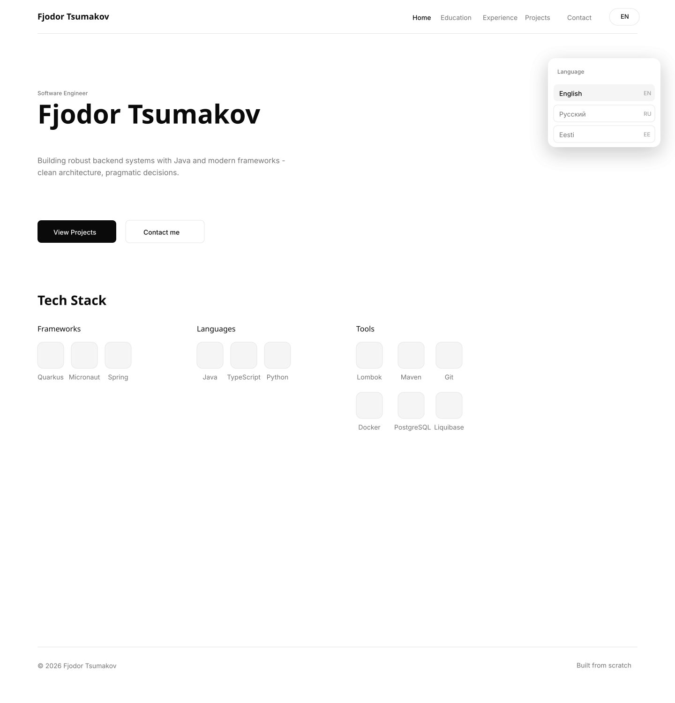

# Web portfolio CMS

## Navigation

- [Description](README.md#description)
- [Tech Stack](README.md#tech-stack)
- [Project Structure](README.md#description)
- [Preview](README.md#preview)
- [Author](README.md#author)
- [License](README.md#license)

## Description

Web Portfolio CMS featuring Clean Architecture and a fully CI/CD pipeline.

## Tech stack

Project build with Clean Architecture in mind.

- Libraries
  - backend
    - Spring
    - Spring security
    - MapStruct
    - robsonkades.UUIDv7
    - LiquiBase
    - Hibernate
    - Swagger
  - backend-testing
    - JUnit
    - AssertJ
    - Mockito
    - RestAssured
  - frontend
    - Angular
    - Swagger CLI generator
  - infrastructure
    - Ansible
    - Docker

- External services
  - PostgreSQL
  - Redis

- frontend
  - Angular
  - Swagger CLI generator

## Project structure

[backend]()

[frontend]()

[infrastructure]()

[docker-compose.yml]()

## Preview

## Author

Fjodor Tšumakov *(NotEvil)*

## License

The project is under [MIT License](LICENSE)